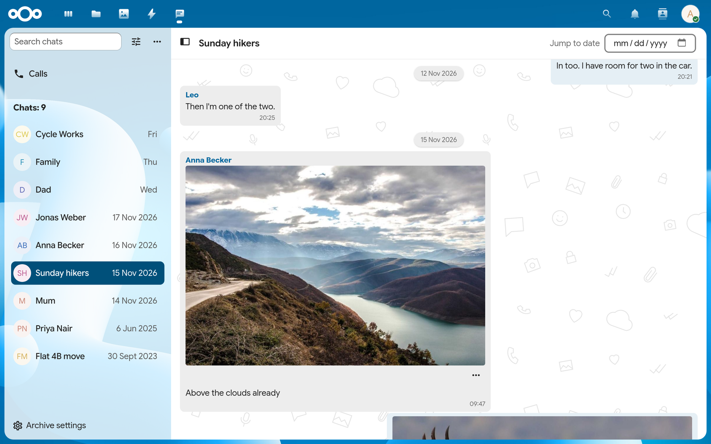
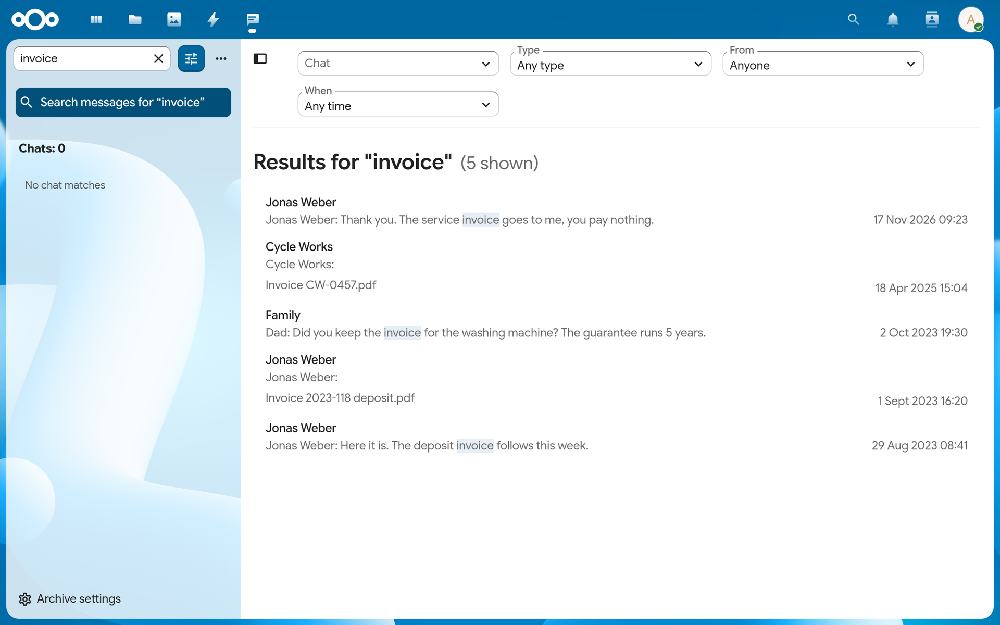
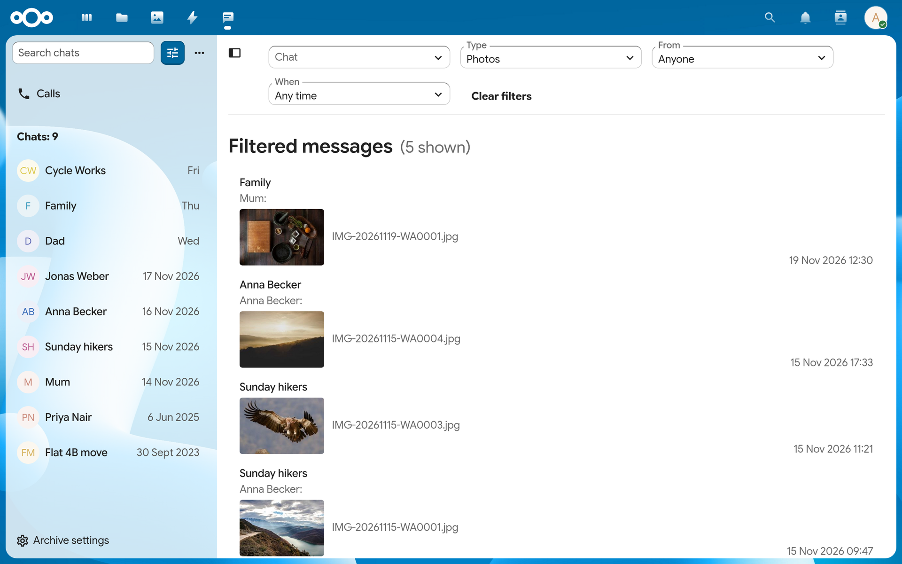
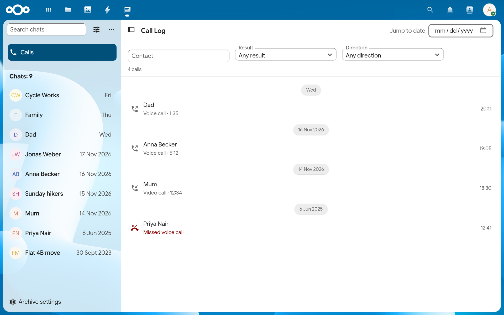

<h1 align="center">Chat Archive</h1>

<p align="center">
  <a href="LICENSE"></a>
  
  
  <a href="docs/USER-GUIDE.md#mcp-support-ai-agents"></a>
</p>

Browse and search your WhatsApp backup inside Nextcloud.

Chat Archive reads the end-to-end encrypted backup that WhatsApp writes on
your phone. The Nextcloud mobile app uploads that backup, together with the
photos, videos, voice notes and documents, to a folder in your Nextcloud.
Chat Archive turns the backup into a searchable archive: every chat, every
message, every call, with the media files opening from the message they came
with.

The files stay yours and stay where the phone put them. You can move, rename
or sort them into other folders, and the chat still opens them.



| Search across all chats | Every photo, from every chat | The call history |
|---|---|---|
|  |  |  |

## Why this exists

I needed one thing the phone does not give you: every message from one date,
across all chats and all groups, in one list. WhatsApp makes you scroll, one
conversation at a time. I also wanted an AI agent that can search those
conversations for me.

I already keep everything in Nextcloud, and the phone already uploads the
backup and the media there. So the archive belongs in Nextcloud too: the
files are in place, the accounts are in place, and nothing has to leave the
server.

## MCP support: ask an AI agent about your chats

Chat Archive makes your WhatsApp history searchable for AI agents through
MCP (Model Context Protocol). Connect an agent such as Claude Code to the
Nextcloud [Context Agent](https://apps.nextcloud.com/apps/context_agent)
MCP server, and ask in plain words:

> "What did we agree about the invoice in March?"
> "Find the photos that Anna sent last week."

The agent gets the tool `search_chat_archive_messages`, with the same
filters as the app: text, date range, chat, type and sender. Each result
links to the message. A photo or document also comes with its path in
your files, so the agent can open the file itself.

The archive stays on your server. The agent sees only the archive of the
user whose app password it uses. The
[user guide](docs/USER-GUIDE.md#mcp-support-ai-agents) shows the setup.

## What it is, and what it is not

Chat Archive is an **archive**. It keeps a private, searchable copy of your
chats on a server you control, so you can find that address, invoice or
photo from three years ago.

Chat Archive is **not a WhatsApp client**. It does not send messages. An
administrator can allow an opt-in, read-only live sync through WAHA; it puts
the WhatsApp number at risk. Read the warning in the
[user guide](docs/USER-GUIDE.md#live-sync-waha) first. The
[roadmap](docs/roadmap.md) gives the reasons for this design.

## Features

- **Chats** with messages, captions and system events, newest first, paged
  as you scroll.
- **Media by pointer**: photos, videos, voice notes and documents open from
  the message. The archive stores the Nextcloud file id, not the path, so a
  file keeps working after you move or rename it anywhere in your storage.
- **Search** across all chats with filters for source, chat, type, sender
  and date. Optional ranked search through the Nextcloud
  [Full text search](https://apps.nextcloud.com/apps/fulltextsearch) app.
- **Calls**: voice and video call history with duration and result.
- **Contact names** from your Nextcloud address books, so a number shows as
  a name.
- **Automatic import** on a schedule (see
  [Import](docs/USER-GUIDE.md#import)), or on demand with one click or one
  `occ` command. Only new messages are added, so re-runs are cheap.
- **Delete policies**: decide per source what happens when you delete a
  linked file elsewhere in Nextcloud.
- **Live sync** (opt-in, read-only, through WAHA): new messages arrive
  between two backups. The administrator allows it per server.
- **Preserve switch**: on by default. It keeps the archive complete; see
  [Preserve the archive](docs/USER-GUIDE.md#preserve-the-archive).
- **More than one source**: WhatsApp and WhatsApp Business side by side.
  The importer is built for other platforms later.
- **Unified search**: the Nextcloud search box finds your messages through
  the search provider of the app, with filters for the term, the date range,
  the chat, the source, the type and the sender. The same provider serves
  AI agents; see [MCP support](#mcp-support-ask-an-ai-agent-about-your-chats).

## Requirements

- Nextcloud 32 to 35
- PHP 8.1 or later with the `pdo_sqlite`, `openssl` and `zlib` extensions.
  The SQLite library of PHP needs the `memdb` VFS and the `sqlite_dbpage`
  table: the import decrypts the backup in memory. The official Nextcloud
  container images have both.
- A working Nextcloud background job (cron)
- On the phone: WhatsApp with end-to-end encrypted backup and the 64-digit
  backup key, and the Nextcloud mobile app with auto upload
- For an install from git only: Node and npm. The
  [Build](docs/DEVELOPER-GUIDE.md#build) section of the developer guide gives
  the versions.

## Install

```sh
cd /path/to/nextcloud/custom_apps
git clone https://github.com/amsys/chat_archive.git chat_archive
cd chat_archive
npm ci
npm run build
sudo -u www-data php ../../occ app:enable chat_archive
```

To update: pull, build again, then run `occ upgrade` so pending migrations
run.

Then set up the backup, the upload from the phone and the source: see the
[user guide](docs/USER-GUIDE.md). The same steps are shown inside Nextcloud
under Settings → Personal → Chat Archive.

## Usage

Open **Chat Archive** from the app menu to read and search the archive. Add
a source under Settings → Personal → Chat Archive first. The
[user guide](docs/USER-GUIDE.md) gives each step.

## Documentation

- [User guide](docs/USER-GUIDE.md): setup, import, search, MCP support, delete policies,
  troubleshooting.
- [Developer guide](docs/DEVELOPER-GUIDE.md): architecture, import, the OCS
  API, build, tests, release.
- [Roadmap](docs/roadmap.md): agent access, live bridge, other platforms.
- [Support](SUPPORT.md): report a bug, ask a question.

## Contributing

Read the [developer guide](docs/DEVELOPER-GUIDE.md) for the build, the tests
and the conventions. Report a bug as [SUPPORT.md](SUPPORT.md) says.

## Donate

If the app is useful to you, you can support the work with a donation in
BTC or XMR. The addresses are in [SUPPORT.md](SUPPORT.md#donate).

## License

AGPL-3.0-or-later. See [LICENSE](LICENSE).
